# Charge-Domain Compute-in-Memory Accelerator for MNIST Inference

A charge-domain SRAM compute-in-memory (CIM) macro that runs the first layer of an MNIST classifier inside the memory array, designed end to end: from neural-network quantisation in MATLAB, through the compute cell, DAC, MAC column and memory organisation, and back to classification accuracy with circuit-level variation included.

Course project for **EE6331: Embedded Memory Design** at IIT Madras (Jan–May 2026), taught by Prof. Janakiraman Viraraghavan. Designed in Electric and LTSpice, with system modelling in MATLAB.

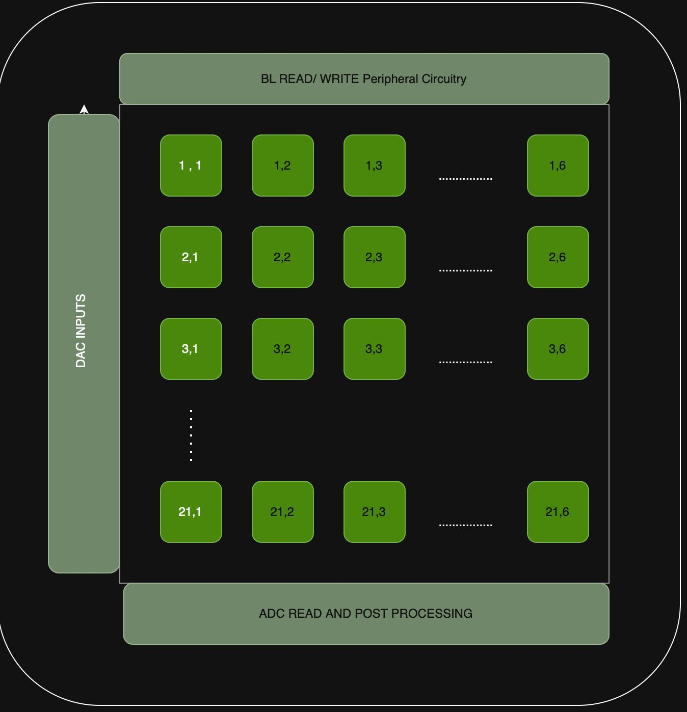

## Team and contributions

| Member | Contribution |
|---|---|
| **N Yasho Srikar Adithya Reddy** | All MATLAB modelling (quantisation, bit-sliced CIM inference, ADC and variation modelling, ENOB, accuracy) and the memory architecture |
| Kirthi Lakshmi | SRAM compute cell sizing and Monte Carlo analysis |
| Nivedha K | DAC sizing, MAC column architecture and Monte Carlo analysis |

Both phases were carried out together as Group 12. The split above describes the final (Phase 2) design; Phase 1 was joint work.

## Results at a glance (final design)

| Metric | Value |
|---|---|
| Precision | 2-bit inputs (B<sub>x</sub>), 6-bit weights (B<sub>w</sub>), 4-bit ADC (B<sub>ADC</sub>) |
| MNIST accuracy with circuit variation | **95.66%** (drop of 0.19%) |
| ENOB from Monte Carlo (σ/Δ<sub>step</sub> = 0.025) | 3 bits |
| MAC latency T<sub>MAC</sub> | **3.12 ns** |
| Throughput | **4.9 TOPS per tile**, 102.9 TOPS per macro (1-bit operations) |
| I<sub>MAC</sub> | 0.134 mA |
| Tile / macro | 32 × 120 cells per tile; 126 tiles (21 × 6) = 483,840 bits, aspect ratio ≈ 1 : 1.07 |
| Compute cell | 9T SRAM (6T + 3T isolation), 26,400 nm² |
| Cell margins | RSNM 0.153 V, WSNM 0.379 V, BLWM ≈ 0.3 V |

## Design flow

```
MNIST network (784 → 100 → 10)
   │  MATLAB: quantisation sweep → Bx = 2, Bw = 6, BADC = 4
   ▼
Bit-sliced charge-domain CIM model (positive / negative weight banks, partial MACs, ADC clipping)
   │
   ▼
Circuits (Electric + LTSpice): 9T compute cell → 2-bit DAC → 32-row charge-sharing MAC column
   │  Monte Carlo: σ of MAC voltage = 0.025
   ▼
MATLAB: σ/Δstep → ENOB = 3 bits → accuracy with variation = 95.66%
```

## 1. Quantisation and system model (MATLAB)

The first layer (784 × 100) of the network is mapped onto the array. Weights are split into **positive and negative banks** whose MAC outputs are subtracted digitally, so the same unsigned array works for any sign of weight. Each 6-bit weight is **bit-sliced** across six 1-bit columns, inputs are applied as 2-bit bit-planes, and each tile's partial MAC is averaged, clipped to the ADC range and quantised by a 4-bit ADC before shift-and-add recombination.

- [`cim_inference_accuracy.m`](matlab/cim_inference_accuracy.m): full bit-sliced CIM inference and accuracy
- [`partial_mac_histograms.m`](matlab/partial_mac_histograms.m): the same flow, also recording weight, input and partial-MAC distributions to size the ADC range
- [`enob_calculation.m`](matlab/enob_calculation.m): ENOB from the Monte Carlo σ/Δ<sub>step</sub> together with ADC quantisation noise

| Positive array output | Negative array output |
|---|---|
| 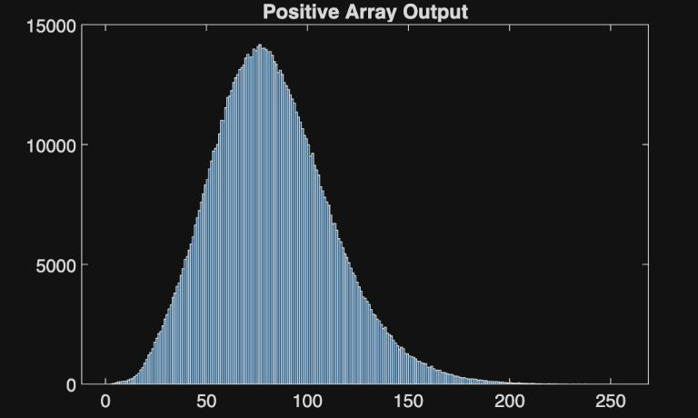 | 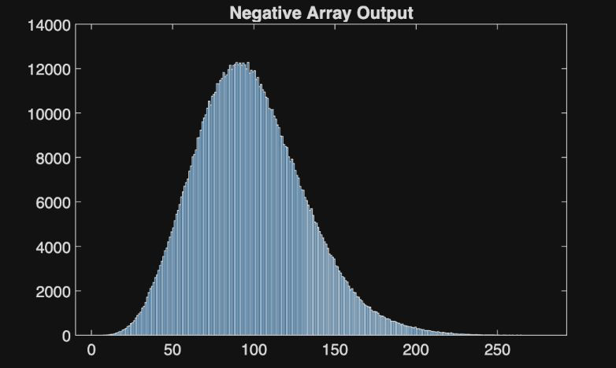 |
| **Layer-1 output before bias** | **Pre-ADC partial MAC distribution** |
| 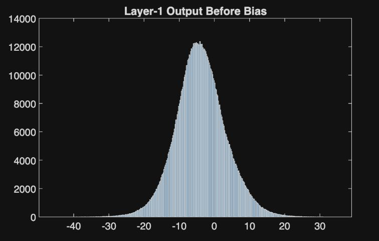 | 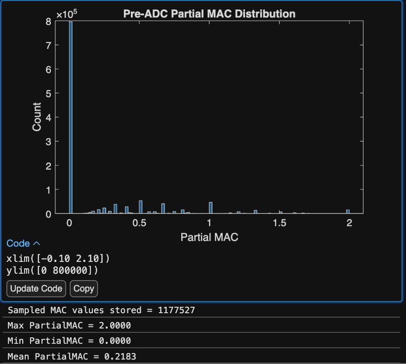 |

## 2. Compute cell: 9T SRAM

A conventional 6T SRAM cell plus a 3T isolation stage (an inverter and an nMOS access transistor to the compute bit line, CBL), so switching noise on the CBL cannot disturb the stored value. Channel lengths of 22 nm and 44 nm were compared; at 22 nm the read margin was close to zero, so 44 nm was chosen, with widths set to balance write margin against cell area.

- pMOS: (44 × 100) × 3 = 13,200 nm²; nMOS: (44 × 50) × 6 = 13,200 nm²; total 26,400 nm² per compute cell
- RSNM = 0.153 V, WSNM = 0.379 V, BLWM ≈ 0.3 V

| Compute cell | Read SNM (Monte Carlo) |
|---|---|
| 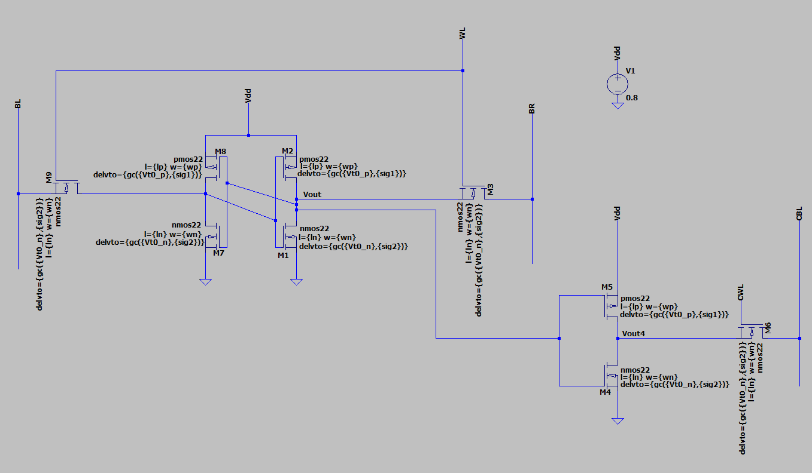 | 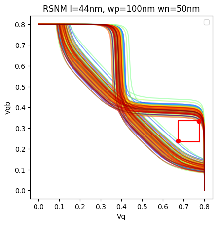 |
| **Write SNM (Monte Carlo)** | **Bit-line write margin (Monte Carlo)** |
| 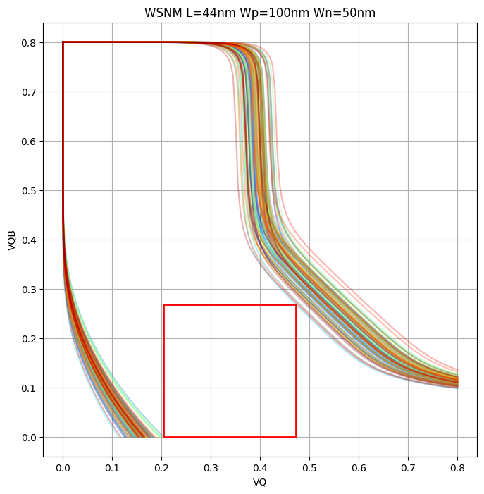 | 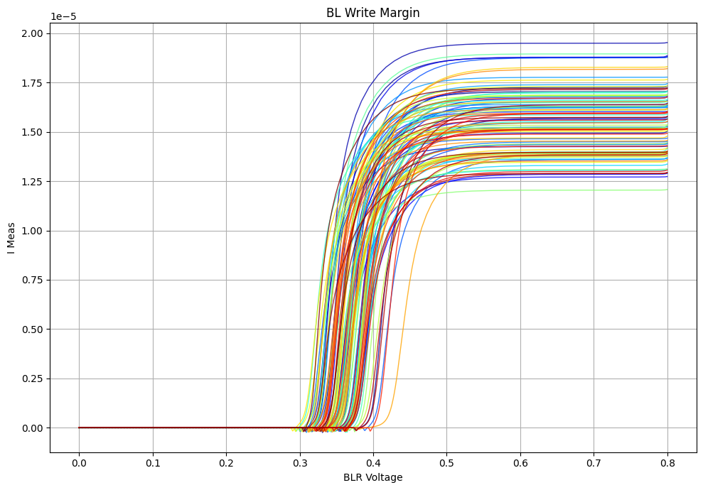 |

## 3. Input DAC

A resistor-string DAC (equal 1 kΩ resistors) with a two-stage 4:1 multiplexer converts each 2-bit input to an analog voltage. Total area ≈ 0.526 µm².

| Code | Output | Maximum settling time |
|---|---|---|
| 00 | 0 mV | 0 ns |
| 01 | 266 mV | 0.2388 ns |
| 10 | 533 mV | 0.55 ns |
| 11 | 800 mV | 0.0955 ns |

| DAC schematic | Output vs time for each code |
|---|---|
| 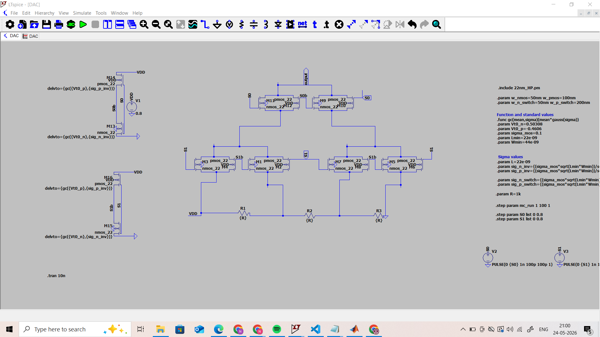 | 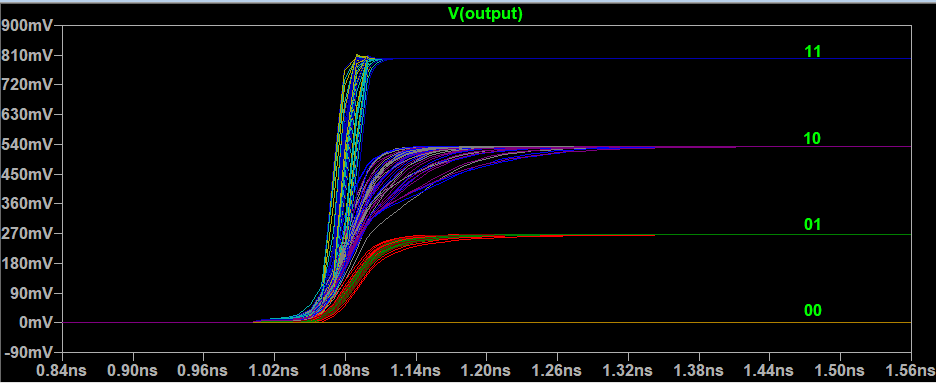 |

## 4. Charge-sharing MAC column

Each column has 32 compute cells. In each cell, the stored weight on the CBL drives a transmission gate that passes the DAC voltage onto a 1 fF capacitor; charge sharing across the 32 capacitors produces an averaged analog MAC voltage, which is buffered and sampled by the ADC.

- MAC range 0–96; the output is linear for MAC values 30–96, with non-linearity at low values likely due to coupling from the transmission gates.
- Monte Carlo σ of the MAC voltage = 0.025, fed back into the MATLAB model.
- Worst-case settling time T<sub>MAC</sub> = 3.12 ns; each column performs 128 1-bit operations (40 1-bit GOPS).
- Compute cell and switch current: 280 nA steady, 1.36 µA peak; I<sub>MAC</sub> = 0.134 mA overall.

| Single-column MAC linearity | Monte Carlo single-column simulation |
|---|---|
| 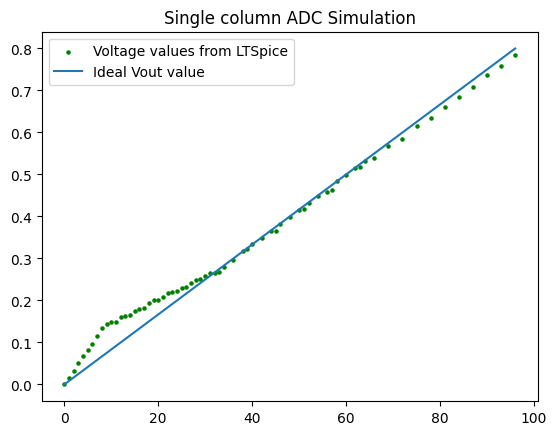 | 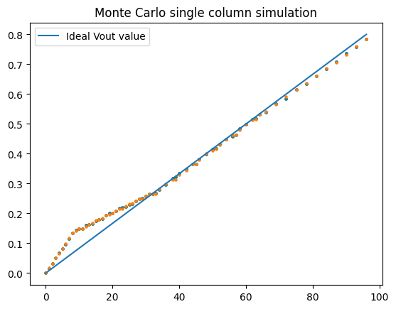 |
| **4-bit ADC quantisation** | **MAC settling time** |
| 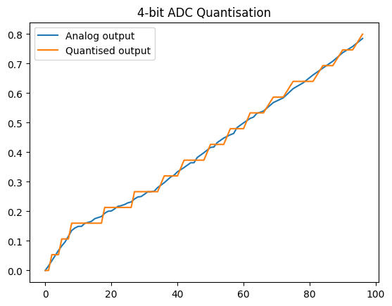 | 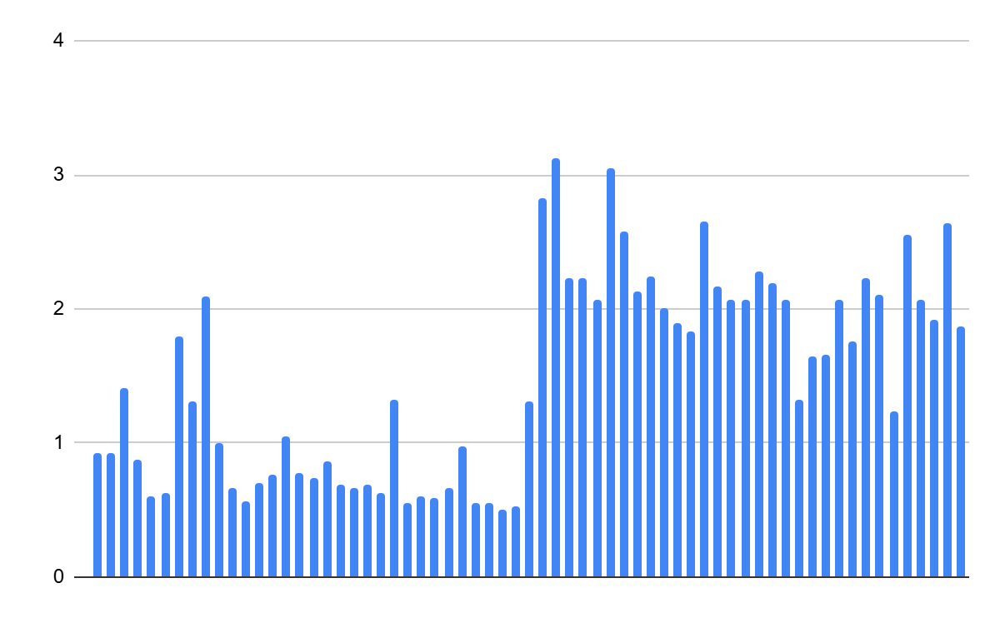 |

## 5. Memory organisation

MNIST's first layer needs 784 × 100 weights × 6 bits = 470,400 bits. Each 32 × 120 tile computes the partial sums of 20 neurons, with 2-bit inputs applied through the DACs and 32-row accumulation on each bit line. The 4-bit ADCs are multiplexed across columns, and the partial MACs are shifted and added digitally. Separate positive and negative weight banks are subtracted after accumulation, so the macro also works for models with only non-negative weights. 126 tiles arranged 21 × 6 give 483,840 bits with an aspect ratio of about 1 : 1.07.

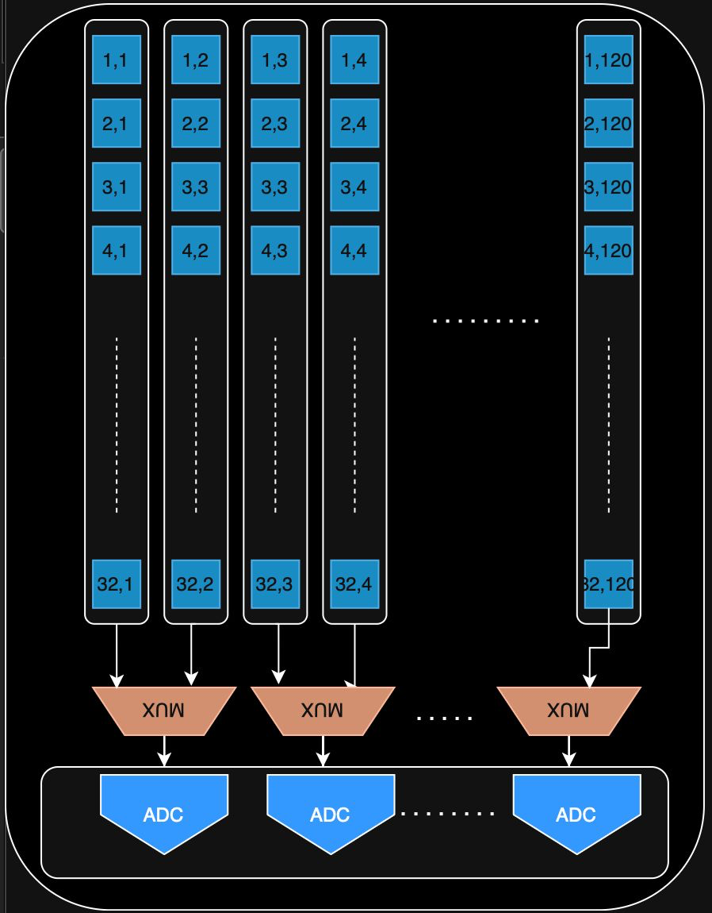

## 6. Variation-aware accuracy

Using the worst-case Monte Carlo metric σ/Δ<sub>step</sub> = 0.025 (Δ<sub>step</sub> = R/2<sup>B<sub>ADC</sub></sup>), the effective number of bits works out to **ENOB = 3**, one bit below the ADC resolution. With this in the MATLAB model, MNIST accuracy is **95.66%, a drop of only 0.19%**, showing that the charge-domain architecture is robust to realistic analog non-idealities and process variation.

## Phase 1: design exploration

The first phase explored a different implementation of the same idea:

- **Quantisation:** inputs 2 bits (unsigned, 2 fractional), weights 6 bits (signed, 3 fractional); clip range R = 15 with a 4-bit ADC.
- **Architecture:** following PICO-RAM, weights are shifted to positive values and the shift is added back digitally; a **C-2C ladder** (after Hechen Wang's C-2C work) performs multi-bit multiplication with fewer unit capacitors than binary-weighted capacitors. Because the column averages the product, clipping at 0.45 with a 7-bit ADC reached **96.78%** accuracy.
- **Circuits:** charge-domain compute (no static current during MAC, low PVT sensitivity, good linearity); 9T cell with hold / read / write SNM of 0.456 / 0.256 / 0.407 V; an R-2R DAC (1 kΩ / 2 kΩ) giving 0, 0.2, 0.4 and 0.6 V; organisation R = 784, C = 600, N<sub>ADC</sub> = 100.

| Hold butterfly | Read butterfly |
|---|---|
| 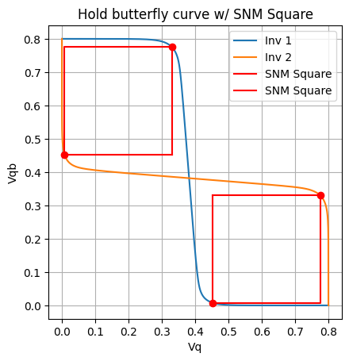 | 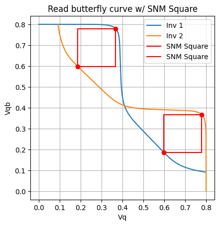 |
| **Write butterfly** | **C-2C column output vs weight** |
| 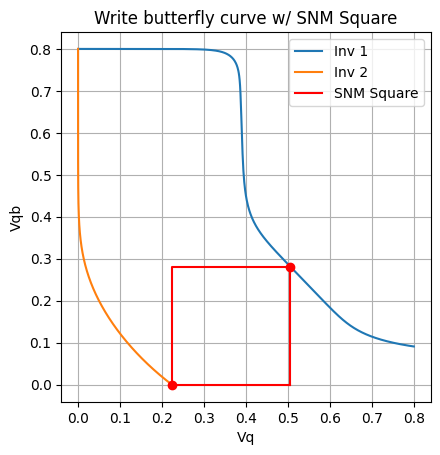 | 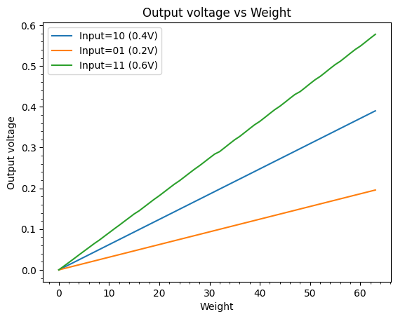 |

## LTspice schematics

The compute cell, input DAC, transmission-gate switch and a weight-row testbench are in [`ltspice/`](ltspice/), with the PTM 22 nm model they use and the Monte Carlo mismatch set-up. See [`ltspice/README.md`](ltspice/README.md).

## Running the MATLAB code

Requires MATLAB with the Fixed-Point Designer toolbox (for `fi`).

```matlab
cd matlab
addpath('provided')
cim_inference_accuracy     % prints the configuration and accuracy
partial_mac_histograms     % also plots the weight, input and partial-MAC distributions
enob_calculation           % ENOB from the Monte Carlo sigma
```

`matlab/mlx/` holds the original live scripts. `matlab/provided/` holds the course-provided MNIST loaders, trained network weights and the MNIST test set (from Yann LeCun's MNIST database; see `References.txt`).

## Repository structure

```
reports/            Phase 1 and Phase 2 reports (Group 12)
figures/phase1/     Phase 1 plots
figures/phase2/     Phase 2 plots and architecture diagrams
matlab/             MATLAB models (.m), original live scripts (mlx/), provided files (provided/)
ltspice/            LTspice schematics, symbols and the PTM 22 nm model
```

## References

- PICO-RAM, for the positive weight-shift scheme
- H. Wang et al., C-2C ladder based charge-domain compute-in-memory
- CAP-RAM: A Charge-Domain In-Memory Computing 6T-SRAM for Accurate and Precision-Programmable CNN Inference
- In-Memory Computation of a Machine-Learning Classifier in a Standard 6T SRAM Array
- A 1-16b Reconfigurable 80Kb 7T SRAM-Based Digital Near-Memory Computing Macro for Processing Neural Networks
